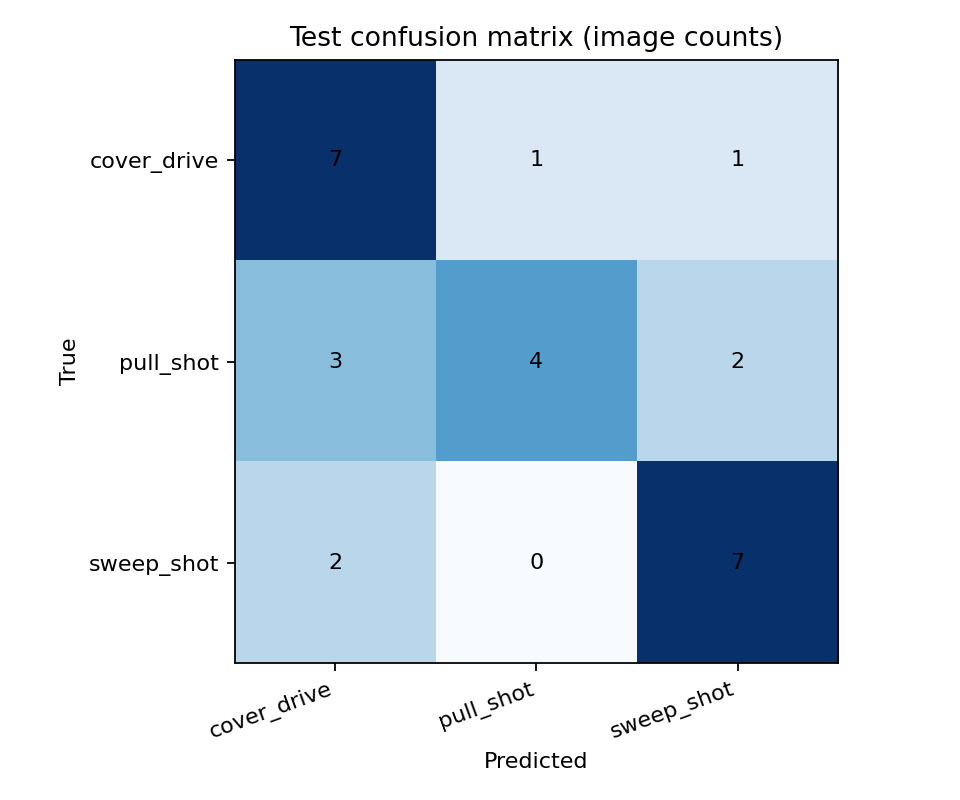

# Initial MVP results

Both models were trained with real, reviewed photographs and ImageNet initialisation. ResNet-18 was selected using validation macro-F1 before the test set was evaluated.

## Data

- 334 real Wikimedia candidate photographs; 138 accepted (46 per class).
- 84 train / 27 validation / 27 test; 33 / 8 / 9 source groups.
- 137 accepted photos by Acabashi and one by Harrias. Expert label verification remains pending.
- Source, photographer/day, hash and known duplicate groups are disjoint across partitions.

## Architecture comparison (validation only)

| Model | Best validation macro-F1 | CPU training time | Parameters (3-class model) | Warm CPU forward latency |
|---|---:|---:|---:|---:|
| resnet18 | 0.688 | 11.5 min | 11,178,051 | 617 ms |
| mobilenet_v3_small | 0.625 | 5.1 min | 1,520,931 | 485 ms |

ResNet was selected. Its best checkpoint is epoch 15, after three fine-tuning epochs. The best head-only validation macro-F1 was 0.523; fine-tuning raised it to 0.688. MobileNet is lighter and trained faster but scored lower on this small validation set.

Times are observations on the shared Linux CPU environment, not laptop speed guarantees. Forward latency uses batch one, four threads, two warmups and five timed repetitions; it excludes loading and image preprocessing. Fewer FLOPs did not translate into a proportional CPU latency gain.

## Held-out test results

**Accuracy: 66.7% (18/27). Macro-F1: 0.658.**

| Class | Precision | Recall | F1 | Support |
|---|---:|---:|---:|---:|
| cover_drive | 0.583 | 0.778 | 0.667 | 9 |
| pull_shot | 0.800 | 0.444 | 0.571 | 9 |
| sweep_shot | 0.700 | 0.778 | 0.737 | 9 |

Training-majority baseline: 33.3% accuracy and macro-F1 0.167. The model improves on that baseline within this particular collection.

Approximate source-group bootstrap 95% intervals: accuracy 38.5–88.9%; macro-F1 0.302–0.857. These wide intervals use only nine held-out groups and do not account for label error, domain shift or selection uncertainty. Do not interpret 66.7% as a general cricket-image accuracy claim.

## Error inspection and bias

All nine misclassifications were visually inspected; see [portable error gallery](test/errors.html) and [per-image scores](test/predictions.csv). The held-out labels and exclusions were not changed after seeing model predictions.

- Pull recall is 4/9; three pulls were predicted as drives and two as sweeps.
- `commons_71510947` is a pull-labelled follow-through predicted as sweep with a score of 0.797. `commons_93766896` is another pull-to-sweep error (0.733). These illustrate that a high softmax score is not reliable certainty.
- `commons_109368326` shows a high follow-through; it is drive-labelled but predicted pull. A single frame loses ball trajectory and temporal context, and similar arm/bat positions can be difficult to distinguish. This is a possible explanation, not a proven causal diagnosis.
- The two missed sweeps, `commons_71510719` and `commons_189851751`, show kneeling poses yet were predicted drive. Pose cues alone are not consistently learned by this baseline.
- Most frames contain another player or wicketkeeper; global image features may incorporate background and kit rather than just the target batter. These shortcuts require further testing.
- Camera framing, pad/aspect ratio, amateur grounds and one dominant photographer limit diversity. Player identities can recur across fixtures; player-independent generalisation was not tested.

## Verified software and remaining work

- 10 unit/contract tests passed; Ruff lint and formatting passed.
- Actual staged training, held-out evaluation and real-image CLI inference completed.
- Streamlit real-image processing and displayed three-class scores passed AppTest. The uploader was mocked with genuine JPEG bytes; a browser file-picker interaction was not manually tested.
- GitHub Actions is configured using current official action major versions, but has not run remotely.
- Code, photographs, manifests and reports are published on `main` in the private `Hazzah1367/cricket-shot-classifier` repository. Trained checkpoints are supplied in the download bundle and excluded from Git. The publish helper is included for future use with a signed-in GitHub CLI.
- Next data iteration: expert verification, additional photographers/matches, batter-focused framing retaining the bat/legs, and a separate phone/broadcast test collection. Preserve this v1 test report rather than repeatedly tuning against it.
